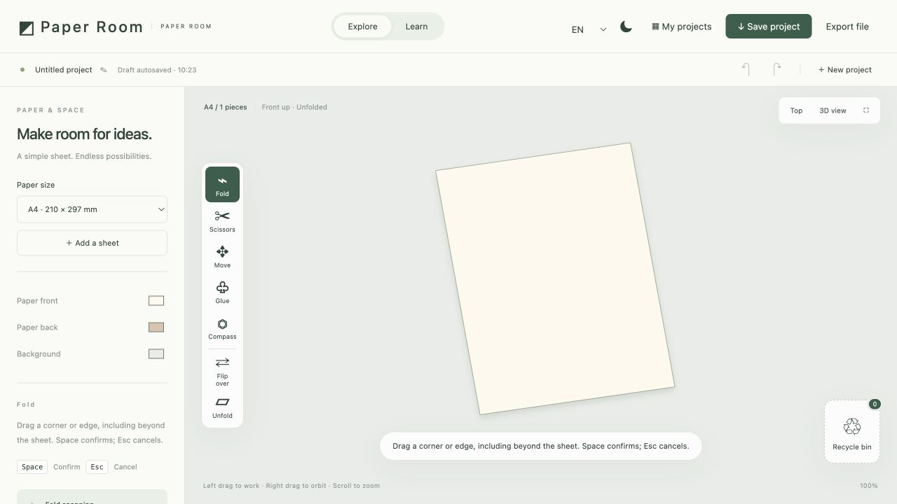

# Paper Room

An interactive website for exploring basic paper folding, cutting and composition.

**[Try the live website](https://paper-room-crystal.wry-toast-5992.chatgpt.site/)** · [Development process](PROCESS.md) · [Credits](CREDITS.md)

## Idea and intended user

Paper Room is designed for beginners who want to experiment with digital origami and paper crafts. Users choose a paper size and fold, cut or combine pieces in a workspace with a three-dimensional view.

The main intention is to make experimentation recoverable. A drag previews a change before the user commits to it. Cancel, undo and the recycle bin help the user recover and decide what to try next.

## Main interaction

1. Select **Fold** and drag from a point on the paper to a target position.
2. The program calculates a fold line and previews the resulting shape.
3. Press **Space** or click **Confirm** to create the fold, or press **Esc** to cancel.
4. The paper changes shape and retains a crease. Continue folding, flip it or unfold it.

Releasing the mouse does not commit a fold. Targets can be outside the original outline. Snapping assists alignment near corners and edges; it is not required for confirmation.

**Input → calculation → visible preview → user decision → updated paper.**

## Screenshot



## Run locally

The application is static HTML, CSS and JavaScript. It has no third-party JavaScript runtime dependencies and requires no API key, AI model or paid account. Use a modern desktop browser with a mouse and keyboard.

Download and extract this repository, or clone it:

```sh
git clone https://github.com/Crystalll0/PAPER-ROOM.git
cd PAPER-ROOM
```

From the directory containing `dist`, start a static server with Python 3:

```sh
python3 -m http.server 8765 --directory dist
```

Open **http://localhost:8765**. Stop the server with **Ctrl+C** in the terminal. Python is only used as a static server, not as the application runtime; another static server can serve `dist` instead. The hosted website is not needed for local use.

The repository version defaults to English. Simplified Chinese and Traditional Chinese remain available as optional interface languages. A previous language choice is retained by the browser.

## Controls and features

| Action | Control |
| --- | --- |
| Preview a fold | Select Fold and drag with the left mouse button |
| Commit or cancel a preview | Space / Confirm, or Esc / Cancel |
| Rotate and zoom | Right-drag, or scroll the mouse wheel |
| Flip or unfold | Select a piece and choose Flip over or Unfold |
| Cut along a crease | Unfold, select Scissors, drag along a crease and confirm |
| Cut a circle | Draw and confirm a circle with Compass, then select its guide with Scissors and confirm |
| Glue pieces | Paint glue, move another piece into contact and confirm |
| Recover an action | Undo or Redo |
| Recycle a piece | Use Move to drag it into the bin |
| Restore a piece | Open the bin and choose Restore |
| Save or back up | Save project or Export file |

Paper sizes include A4, A3, square, rectangular and narrow star-strip paper. The workspace also includes adjustable paper/background colours, light/dark themes, folders, project renaming and JSON import/export.

## Error handling

- Cancelling an exploratory drag leaves no new crease.
- A proposed fold line that does not pass through the material is not accepted.
- Partial cuts do not prematurely separate a sheet. Crease and cut marks stay within their owning pieces.
- Invalid imported files produce an error message.
- If browser storage fails, the workspace is retained and an export option remains available. Creating a new project does not clear the current work after a failed save.
- Recycled pieces can be restored individually or together.

## Saving and privacy

Projects and drafts use this browser's local storage. They are not automatically uploaded or synchronised across devices. Clearing site data can remove saved projects; export a JSON backup to keep a separate copy.

The hosted website and a locally served copy use separate storage. Export and import files to move projects between them.

## Known limitations

This is a polygon-based folding prototype with three-dimensional projection, not a complete physical simulation of flexible paper. It supports straight, flat folds and moves the layers on one side together. It does not simulate curling, realistic collisions, individual-layer selection or complex reverse folds.

Cutting and painting glue require unfolded paper. Partial cuts do not simulate local bending. Circular cuts use a 96-sided approximation. Glued pieces move as a group; a self-glued fold must be undone before unfolding. Many successive operations can increase the computational workload.

The learning section currently introduces basic controls; it does not yet include tutorials for making specific origami models. Future iterations may add detailed, step-by-step guides for shapes such as hearts, cranes, stars and Christmas trees. Desktop mouse and keyboard use is the primary target.

## Source and checks

```text
dist/
  index.html       Page structure
  style.css        Interface styles
  app.js           Input, interface and browser storage
  engine.js        Folding, cutting and gluing geometry
  i18n.js          Interface language strings
tests/
  geometry.cjs     Geometry regression checks
  workspace.cjs    Application-state checks
docs/
  workspace.png    Screenshot
```

With Node.js installed, run:

```sh
node tests/geometry.cjs
node tests/workspace.cjs
```

No test packages need installing. The workspace tests use a minimal DOM substitute; they are not full browser automation or a substitute for a trial with another person.

## Authorship and submission status

OpenAI Codex assisted with implementation, debugging, testing and documentation. The author's design decisions and AI-use disclosure are in [PROCESS.md](PROCESS.md). Tool and material credits are in [CREDITS.md](CREDITS.md).

**Work in progress:** the trial with another person and the final fresh-terminal check are still pending. The development timeline and current trial plan are recorded in [PROCESS.md](PROCESS.md).
